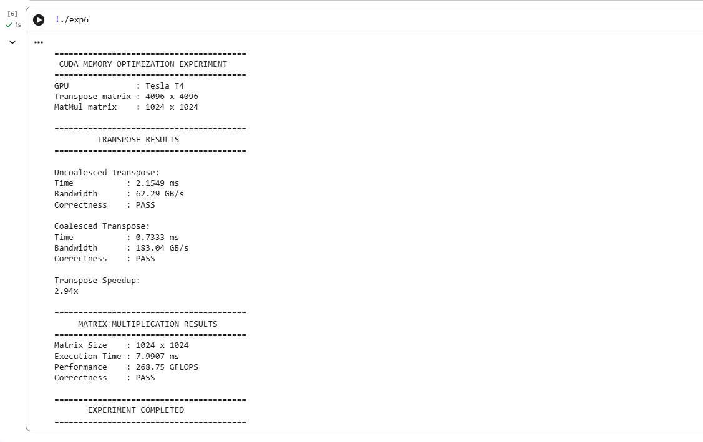
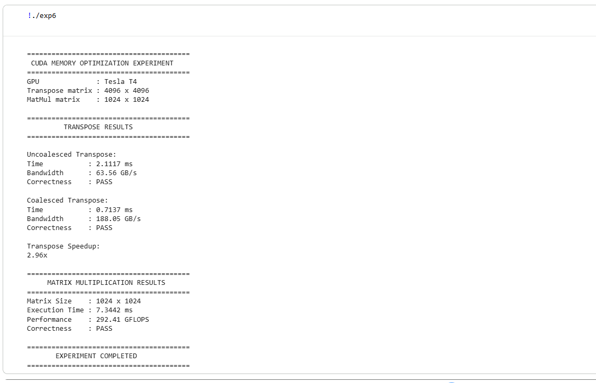
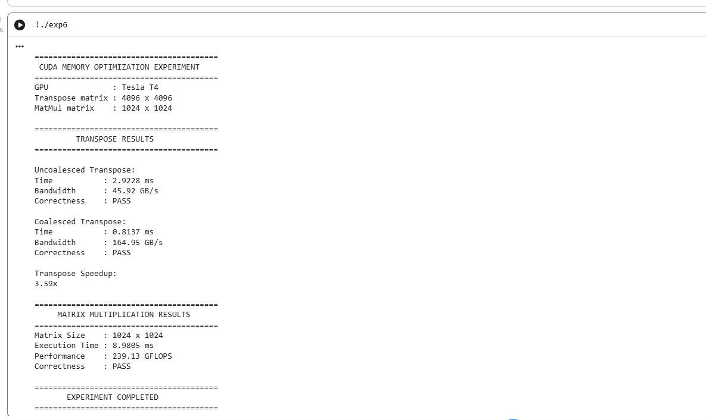

# Experiment 6: CUDA Memory Optimization

## Overview

This experiment investigates GPU memory access optimization using CUDA. It compares uncoalesced and coalesced memory access patterns during matrix transpose and evaluates GPU performance using matrix multiplication.

The experiment was executed using an NVIDIA Tesla T4 GPU in Google Colab. Three independent runs were performed to observe performance consistency and calculate average measurements.

## Objectives

- Understand GPU global memory access patterns.
- Compare uncoalesced and coalesced memory access.
- Implement shared-memory tiled matrix transpose.
- Measure execution time and effective memory bandwidth.
- Calculate transpose performance speedup.
- Implement CUDA matrix multiplication.
- Evaluate matrix multiplication performance in GFLOPS.
- Verify computational correctness.

## Hardware and Software Environment

| Component | Specification |
|---|---|
| GPU | NVIDIA Tesla T4 |
| Platform | Google Colab |
| Programming Language | CUDA C++ |
| Compiler | NVIDIA CUDA Compiler (NVCC) |
| Transpose Matrix | 4096 × 4096 |
| Matrix Multiplication | 1024 × 1024 |

## Experiments Performed

### 1. Uncoalesced Matrix Transpose

The uncoalesced transpose implementation accesses global memory in a pattern that is less efficient for GPU memory transactions.

This implementation is used as the baseline for comparison.

### 2. Coalesced Matrix Transpose

The optimized transpose implementation uses shared-memory tiling to improve memory access patterns.

Coalesced memory access allows neighboring threads to access neighboring memory locations more efficiently, improving memory bandwidth utilization.

### 3. CUDA Matrix Multiplication

Matrix multiplication is performed on the GPU using CUDA. Execution time and computational performance are measured for a 1024 × 1024 matrix.

## Experimental Results

Three independent runs were performed using the same GPU and matrix dimensions.

### Table 1: Matrix Transpose Performance

| Metric | Run 1 | Run 2 | Run 3 | Average |
|---|---:|---:|---:|---:|
| Uncoalesced Time (ms) | 2.1549 | 2.1117 | 2.9228 | 2.3965 |
| Uncoalesced Bandwidth (GB/s) | 62.29 | 63.56 | 45.92 | 57.26 |
| Coalesced Time (ms) | 0.7333 | 0.7137 | 0.8137 | 0.7536 |
| Coalesced Bandwidth (GB/s) | 183.04 | 188.05 | 164.95 | 178.68 |
| Transpose Speedup | 2.94× | 2.96× | 3.59× | 3.16× |

### Table 2: Matrix Multiplication Performance

| Metric | Run 1 | Run 2 | Run 3 | Average |
|---|---:|---:|---:|---:|
| Matrix Size | 1024 × 1024 | 1024 × 1024 | 1024 × 1024 | 1024 × 1024 |
| Execution Time (ms) | 7.9907 | 7.3442 | 8.9805 | 8.1051 |
| Performance (GFLOPS) | 268.75 | 292.41 | 239.13 | 266.76 |
| Correctness | PASS | PASS | PASS | PASS |

### Performance Analysis

The coalesced transpose achieved better performance than the uncoalesced transpose in all three runs.

- Average uncoalesced execution time: **2.3965 ms**
- Average coalesced execution time: **0.7536 ms**
- Average speedup: **3.16×**
- Average uncoalesced bandwidth: **57.26 GB/s**
- Average coalesced bandwidth: **178.68 GB/s**

The coalesced implementation achieved approximately 3.12 times the average memory bandwidth of the uncoalesced implementation.

The results demonstrate that optimizing global memory access patterns and using shared memory can significantly improve matrix transpose performance.

Matrix multiplication achieved an average performance of **266.76 GFLOPS** across the three executions.

Small variations in execution time and throughput were observed between runs.

## Screenshots of Experimental Results

### Run 01



### Run 02



### Run 03



## Project Structure

```text
Experiment-6-CUDA-Memory-Optimization/
│
├── exp6.cu
├── results.txt
├── Experiment6_CUDA_Memory_Optimization.ipynb
├── README.md
│
└── evidence/
    ├── 01.png
    ├── 02.png
    └── 03.png
```

## How to Execute

The experiment can be executed in Google Colab with a GPU runtime.

### 1. Compile the CUDA program

```bash
nvcc -O2 -o exp6 exp6.cu
```

### 2. Execute the program

```bash
./exp6
```

### 3. Optional: Execute using smaller matrix dimensions

```bash
./exp6 2048 512
```

The first argument specifies the transpose matrix dimension and the second argument specifies the matrix multiplication dimension.

## Conclusion

This experiment demonstrates the importance of efficient GPU memory access patterns.

The coalesced matrix transpose implementation achieved an average speedup of approximately **3.16×** over the uncoalesced implementation. It also increased average effective memory bandwidth from **57.26 GB/s to 178.68 GB/s**.

All three executions passed their correctness checks. The matrix multiplication implementation achieved an average performance of **266.76 GFLOPS**.

The experiment highlights the benefits of memory coalescing and shared-memory optimization in CUDA programming.

---

**Experiment Status: Completed Successfully**

**All three runs: Correctness PASS.**
